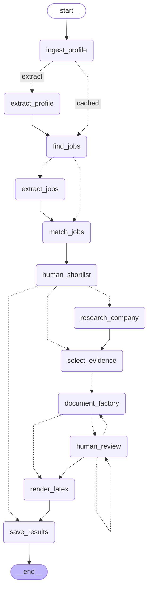

# CareerGraph

A personal, single-user job-search copilot built as an explicit LangGraph graph. It reads your
CV and GitHub, finds postings on public job boards, scores them deterministically, asks **you**
to shortlist, then drafts a CV and cover letter for each approved job where every claim cites
your own evidence, verifies those claims, and renders LaTeX. It never applies and never sends
anything. You are always the approver.

## Use it in 5 minutes

```bash
make setup     # install (uv, Python 3.12)
make init      # create .env (demo mode) and profiles/me/ from the example
make doctor    # OK/WARN/FAIL checklist with the next action for each line
make demo      # full end-to-end run with the fake LLM: no keys, no network, fictional user
make ui        # open the Streamlit UI on http://127.0.0.1:8501
```

### The only files you touch

| Want to change | Where |
|---|---|
| Secrets, mode, models, budgets, switches | `.env` (copied from the fully commented `.env.example`) |
| Which jobs to look for (titles, locations, sources, companies, max age) | `config/search.yaml` |
| How matches are scored (weights, filters, dealbreakers) | `config/criteria.yaml` |
| Who I am (identity facts) and which documents or GitHub account to ingest | `config/profile.yaml` plus the documents in `profiles/me/` |
| Skill aliases and related skills used for normalisation and partial credit | `config/skills.yaml` |
| Model prices (optional, for USD estimates) | `config/pricing.yaml` |
| How the CV and letter look | `templates/` (or your own in `profiles/me/templates/`) |
| Every command | `Makefile` (`make help` lists all targets) |

### Day-to-day workflow

```bash
make run                     # find, analyse and score jobs; stops at the shortlist pause
make pending                 # threads waiting for you (come back hours later; state is durable)
make shortlist THREAD=<id>   # see ranked jobs with score breakdown and matched/missing skills
make approve THREAD=<id> JOBS=<job1>,<job2> REJECT=<job3>:too_junior
                             # drafts + verifies documents, stops at the review pause
make review THREAD=<id>      # approve drafts -> LaTeX in outputs/<date>/<company>-<role>/
make tracker                 # applications marked "ready"
```

Cron or a Kubernetes CronJob runs the same `careergraph run`; you approve later in the UI or CLI.

### What each pause expects from you

1. **Shortlist pause** (`human_shortlist`): for each ranked job choose `approve`, `reject` or
   `defer`, optionally with reason tags (`too_junior`, `too_senior`, `wrong_location`,
   `not_my_domain`, `salary`, `company`, `other`) and a note. Tags teach the matcher your
   preferences for the next run (stored in the LangGraph Store). Jobs flagged for prompt
   injection are marked; read them yourself.
2. **Review pause** (`human_review`, skip with `REQUIRE_DOCUMENT_REVIEW=false`): for each draft
   choose `approve`, `edit` (your patch is re-verified), `regenerate` or `reject`. Drafts that
   still contain unsupported claims after `MAX_REVISIONS` cannot be approved without an
   explicit override.

### Going live

Set `APP_MODE=live` and `ANTHROPIC_API_KEY` in `.env`, fill `config/profile.yaml`, put your CV
in `profiles/me/`, add real board slugs to `config/search.yaml`, then `make doctor`.
Details: [docs/live-mode.md](docs/live-mode.md).

## Architecture

<!-- graph:job_search:start -->

<!-- graph:job_search:end -->

