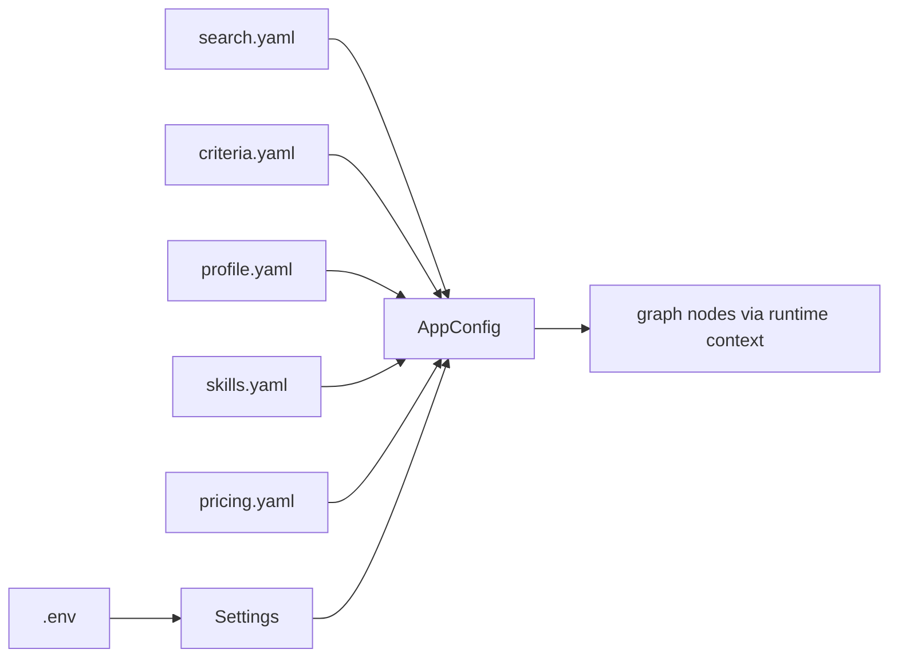

# config/

## Purpose
User-editable YAML that controls *what* CareerGraph does. Secrets and switches live in `.env`;
everything about your search, scoring and identity lives here. You never need to open `src/`.

## How it works
`src/careergraph/config.py` loads each file into a strict Pydantic model (`extra="forbid"`), so
a typo is reported as `file: key: problem. Fix: ...` instead of being silently ignored. All
files are validated together at startup and by `make doctor`.

## Key files
| File | Controls | Read by |
|---|---|---|
| `search.yaml` | job sources (Greenhouse, Lever, Ashby, RSS), title/location filters, max age, company sites for research | `find_jobs`, `research_company` |
| `criteria.yaml` | criterion weights, threshold, top N, dealbreakers, related-skill credit, preference learning | `match_jobs` |
| `profile.yaml` | identity facts (never LLM-generated), experience, education, documents folder, GitHub user | `ingest_profile`, `verify_documents`, `render_latex` |
| `skills.yaml` | alias normalisation and related skills | profile + job extraction, matching |
| `pricing.yaml` | optional per-model prices (shipped empty) | budgets, doctor, insights |

## LangGraph concepts used and why
None directly: config reaches nodes through the runtime context (`Services.cfg`), so graph
code never reads files or environment variables and stays identical in demo and live mode.

## Demo vs live
In demo mode `search.yaml` and `profile.yaml` are read from `data/demo/` (fictional companies
and the fictional user Sam Demo) so the demo is reproducible. `criteria.yaml`, `skills.yaml`
and `pricing.yaml` are always read from here, so you can experiment with scoring in demo mode.

## Configuration rules
- Every key has a comment above or beside it: what it does, allowed values, default.
- `tests/test_drift_guard.py` fails if a key is undocumented, uncommented or unused by code.
- The live `search.yaml` ships with **placeholder** board slugs (`REPLACE_WITH_...`,
  `enabled: false`); CareerGraph never invents company slugs.

## How to test
`make doctor` (or `uv run careergraph validate-config`) and `uv run pytest tests/test_config.py`.

## Design decisions and trade-offs
YAML for things you tune often (readable, commentable, diffable), `.env` for secrets and
switches (12-factor, works in Docker/Kubernetes). Strict models catch typos at startup instead
of silently ignoring a misspelled key; the cost is that unknown keys are errors.

## Gotchas
- Weights are relative; they are normalised to sum to 1.
- Skill names are canonicalised to lowercase; add aliases rather than duplicating skills.
- Prices change. Copy current ones from your provider; USD caps only apply when both input and
  output prices are set for a model.
