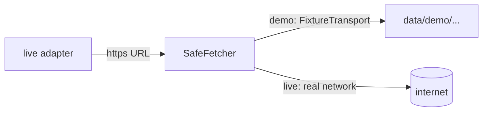

# data/demo/

## Purpose
A complete, **fictional** world for demo mode, tests and fake-mode evals: one user, seven
companies, thirty postings, a GitHub profile and company web pages. Nothing here is real:
names, employers, universities, board slugs and numbers are invented, and web domains use the
reserved `.example` TLD.

## How it works
In demo mode the real adapters run against these files: a fixture HTTP transport serves them
for the exact URLs the live adapters request (Greenhouse, Lever, Ashby, RSS, GitHub, company
pages, search APIs), so parsing, SSRF checks, caching and filtering are exercised without any
network access.

## Key files
| Path | What |
|---|---|
| `manifest.yaml` | fixed demo "today" (2026-11-20) so ages and trends are reproducible |
| `search.yaml` | demo search config: 6 fictional boards + 1 RSS feed, filters, company sites |
| `profile/` | Sam Demo: `profile.yaml` (identity facts), `cv.md`, `letter_platform.md`, `letter_llm.tex`, `evidence.yaml` (1 pinned item) |
| `github/sam-demo-example.json` | 6 repos (1 fork that must be skipped), languages, READMEs |
| `postings/{greenhouse,lever,ashby}/*.json`, `postings/rss/*.xml` | 30 postings in each ATS's public payload shape |
| `web/<domain>/...` | company pages for research (one contains an injection line; one `robots.txt` disallows `/private/`) |
| `web/search_index.yaml` | canned results for the keyed search providers in demo mode |
| `evals/` | gold files: triage labels, expected skills, funnel statuses, injection labels, seeded claims, thresholds |
| `build_fixtures.py` | regenerates postings, GitHub data and generated gold files from hand-written specs |

## The posting mix
Strong, medium and weak fits; 3 prompt-injection payloads (plain text, hidden HTML, a fake
"Assistant:" turn); 2 near-duplicate pairs; 1 German posting; postings filtered by title and by
age; red flags (`unpaid`, `rockstar`, `24/7`); salaries in EUR, GBP and USD; dates spread
over ~10 weeks for the skills-demand chart.

## LangGraph concepts used and why
The fixtures make the whole graph deterministic, so tests can assert exact routing (which
jobs fan out, which draft revises), interrupts, crash resume and time travel.

## Configuration
`APP_MODE=demo` selects this folder for search and profile. `DEMO_FABRICATE_JOB`
(default `gh-nimbus-analytics-4001`) makes the first draft for that job contain a fabricated
claim so the verify -> revise loop is visible.

## How to run and test
`make demo`; `uv run python data/demo/build_fixtures.py` to regenerate (output is committed).

## Design decisions and trade-offs
Fixtures mimic real payloads (field names verified against the public Greenhouse, Lever and
Ashby docs on 2026-11-22) rather than a simplified format, so the adapters' parsing code is
what the demo tests. The cost is larger fixture files.

## Gotchas
Gold files under `evals/` (except `seeded_claims.yaml` and `thresholds.yaml`) are generated;
edit the specs in `build_fixtures.py`, not the YAML.
