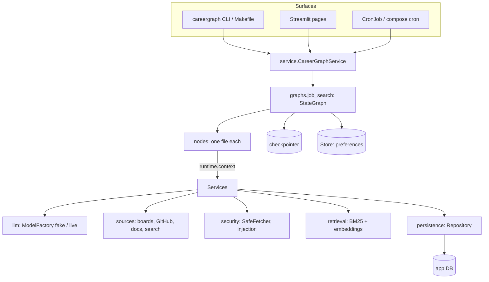

# Architecture

## Layers

Demo and live differ only in `service/wiring.py`: the HTTP transport + resolver (fixtures vs
internet), the model factory (fake vs `init_chat_model`), the clock and the embedding backend.

## Data flow of one run
1. `ingest_profile` hashes documents/repos; `extract_profile` runs only when they changed.
2. `find_jobs` pulls boards, filters, dedupes, reuses analyses by content hash, caps new ones.
3. `extract_jobs` fans out (Send) one tool-less, structured call per new posting.
4. `match_jobs` scores deterministically (+ learned preferences from the Store).
5. `human_shortlist` interrupts. Hours later, the UI/CLI resumes it.
6. Optional `research_company` per job (ReAct subgraph, capped).
7. `select_evidence` joins; `document_factory` per job drafts JSON and verifies each claim,
   revising up to `MAX_REVISIONS`.
8. `human_review` interrupts; edits are re-verified; flagged drafts need an override.
9. `render_latex` fills templates; `save_results` marks applications ready.

## Persistence
App tables (SQLAlchemy) + LangGraph checkpointer + Store: SQLite files under `DATA_DIR` by
default, one Postgres database when `DATABASE_URL` is set. See ADR 0003.

## Verified APIs
Checked in this development session (2026-11-22) by reading installed source / running code
or official docs. Re-verify when upgrading.

| What | Version | How verified | Finding |
|---|---|---|---|
| `StateGraph`, `Send`, `interrupt`, `Command(resume=)` | langgraph 1.2.24 | spike scripts | pause/resume, crash resume from checkpoint, Send fan-out + reducers work as used |
| Interrupt inside Send branches | 1.2.24 | spike | works (one interrupt per branch, separate ids); CareerGraph keeps pauses top-level |
| Routing N branches to one node | 1.2.24 | spike | target runs once (join); Send-returning routers would multiply |
| Conditional-edge functions with `runtime` | 1.2.24 | spike | supported |
| Subgraph `.invoke(context=...)` inside a Send branch under a checkpointed parent | 1.2.24 | spike | works |
| `ToolNode` + `ToolRuntime` (`.context`, `.state`) | langgraph-prebuilt 1.1.3 | spike | works; pydantic emits a harmless serializer warning (silenced) |
| `get_state_history` / `update_state(as_node=)` | 1.2.24 | spike + tests | configs passed to `update_state` must include `checkpoint_ns` (`get_state()` omits it) |
| Checkpoint serializer | langgraph-checkpoint 4.3.2 | source + test | unregistered types warn and "will be blocked"; domain types are allow-listed |
| `SqliteSaver`, `SqliteStore` | -sqlite 3.1.3 | source + tests | Store needs its own autocommit connection |
| `PostgresSaver`, `PostgresStore` | -postgres 3.2.1 | test against local postgres:17-alpine | pause/resume, Store, history verified |
| `init_chat_model`, `with_structured_output(method="json_schema")`, `effort` | langchain 1.5.2 / langchain-anthropic 1.7.12 | source + offline construction | no forced tool choice needed; temperature not sent |
| Model ids `claude-haiku-5-5`, `claude-sonnet-5-5` | Anthropic docs (cached 2026-11-03) | Claude API reference | **no live call made** |
| Streamlit `AppTest`, `st.status`, `st.page_link` | 1.67.0 | tests | `page_link` paths are relative to the entrypoint |
| Greenhouse / Lever / Ashby endpoints and fields | official docs + live samples, 2026-11-22 | research | see `src/careergraph/sources/README.md` |
| GitHub REST endpoints, API version | docs 2026-11-22 | research | `2022-11-28` stays supported until 2028-03-10 |
| Tavily / Brave search APIs, free tiers | provider pages 2026-11-22 | research | Tavily 1,000 credits/month; Brave has no free plan ($5 monthly credit) |
| Tectonic V1 CLI flags | Tectonic book | docs | `-o`, `--untrusted`; engine not installed, compile unverified |
| GitHub Actions versions | releases 2026-11-22 | research | see `.github/README.md` |
