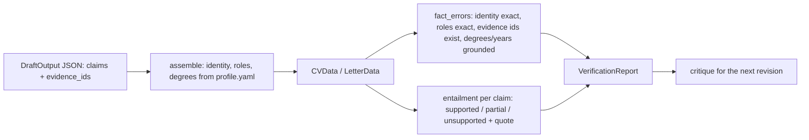

# documents/

## Purpose
Everything between "the model wrote JSON" and "a human approves": evidence selection,
identity injection, claim addressing and patching, deterministic fact checks, review payloads
and the per-application `report.md`.

## How it works

## Key files
`assemble.py`, `claims.py` (ids like `cv.experience.0.bullets.2`, `apply_patch`),
`verify.py`, `review.py`, `report.py`.

## LangGraph concepts used and why
Used by the `document_factory` subgraph and the `human_review` interrupt.

## Configuration
`config/profile.yaml` (identity facts), `MAX_REVISIONS`.

## How to test
`uv run pytest tests/test_documents.py tests/test_routing.py`.

## Design decisions and trade-offs
The LLM never writes LaTeX or identity facts (ADR 0006). Fact checks are cheap and exact;
entailment needs a model and is probabilistic, so both are combined and every label carries
the evidence quote a human can check.

## Extending and gotchas
Claim ids are positional: after a patch deletes a claim, later ids shift.
