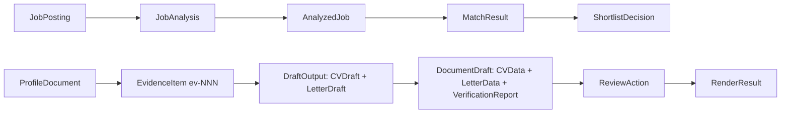

# domain/

## Purpose
Pydantic v2 schemas shared by graph nodes, the service layer, the UI and evals, plus the
application status enum with its allowed transitions.

## How it works

## Key files
| File | Contents |
|---|---|
| `models.py` | every schema; LLM-facing ones are `ProfileExtraction`, `JobAnalysis`, `MatchRationale`, `DraftOutput`, `Entailment`, `ResearchBrief` |
| `status.py` | `ApplicationStatus` (saved, ready, applied, screening, interview, offer, rejected, withdrawn) and `check_transition` |

## LangGraph concepts used and why
Schemas are stored in graph state and in checkpoints, so they must serialise cleanly (the
checkpointer's serializer handles Pydantic models). Interrupt payloads and resume values are
built from these models (`ShortlistDecision`, `ReviewAction`) and validated on resume.

## Design decisions and trade-offs
- **LLM schemas are deliberately simple**: no numeric or length constraints, because provider
  structured-output features support only a subset of JSON Schema. Limits (80-word summary,
  evidence ids exist) are enforced in code after parsing.
- **The LLM never produces identity facts**: `CVDraft` has no name, employer dates or degrees.
  `CVData` gets those from `config/profile.yaml`; `RoleBullets.employer` must match exactly.
- **Every claim carries `evidence_ids`** (`Claim`), which is what makes verification possible.
- `DocumentDraft.patch` edits are keyed by claim id (`cv.summary.0`, `letter.paragraphs.1`)
  so the UI and CLI can edit a single sentence and re-verify it.

## Configuration
None. Schemas are code; user-facing values come from `config/` and `.env`.

## How to test
`uv run pytest tests/test_llm.py tests/test_tracker.py` (schemas are exercised everywhere).

## Extending and gotchas
- Adding a field to an LLM schema changes the prompt contract: update `llm/prompts.py`, the
  fake handler in `llm/fake.py` and the eval gold if relevant.
- Status transitions are validated; add new statuses to `TRANSITIONS` or updates will fail.
