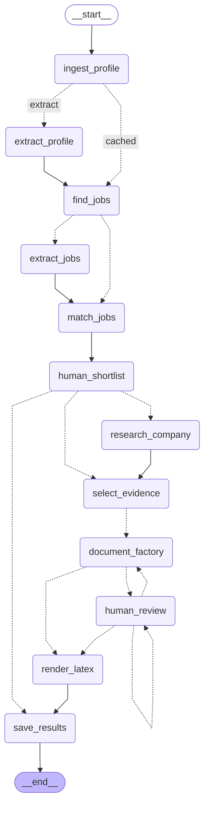
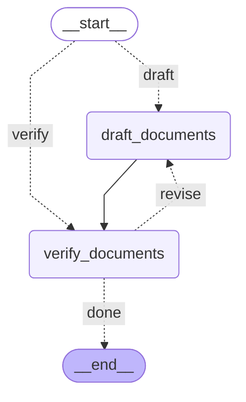
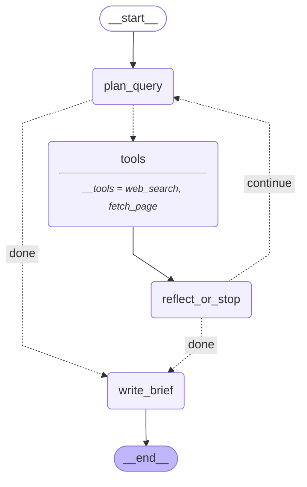

# graphs/job_search/

## Purpose
The `job_search` graph: CareerGraph's whole workflow as one explicit LangGraph `StateGraph`,
with two human pauses. `graph.py` is the table of contents; read it top to bottom.

## How it works
Generated from the compiled graph by `make docs-graphs` (CI fails if stale):

<!-- graph:job_search:start -->

<!-- graph:job_search:end -->

`document_factory` subgraph (per approved job, via Send):

<!-- graph:document_factory:start -->

<!-- graph:document_factory:end -->

`research_company` subgraph (optional, per approved job, via Send):

<!-- graph:research_company:start -->

<!-- graph:research_company:end -->

## Key files
| File | What |
|---|---|
| `graph.py` | wiring of the main graph and the partial `jobs`/`profile` graphs |
| `state.py` | `JobSearchState` and reducers |
| `routing.py` | every conditional edge / Send fan-out |
| `context.py` | `Ctx = Runtime[Services]` |
| `nodes/` | one file per node |
| `subgraphs/` | `document_factory`, `research_company`, tools, subgraph state |

## Node cards
| Node | Purpose | Reads | Writes | LLM | Config knobs |
|---|---|---|---|---|---|
| `ingest_profile` | read documents, GitHub, pinned evidence; cache lookup | `force_profile` | `documents`, `pinned`, `profile_key`, `profile_cached`, `profile`? | deterministic | `profile.yaml` documents/github, `GITHUB_TOKEN` |
| `extract_profile` | evidence items `ev-NNN` with normalised skills; skipped when hashes unchanged | `documents`, `pinned` | `profile` | cheap, 1 call/document | `CHEAP_MODEL`, `skills.yaml` |
| `find_jobs` | fetch boards, filter, dedupe, reuse cached analyses, cap | config | `to_analyse`, `analyses` (cached), `funnel` | deterministic | `search.yaml`, `MAX_JOBS_PER_RUN` |
| `extract_jobs` (Send) | injection scan + `JobAnalysis` per posting, persisted | `{posting}` | `analyses[id]` | cheap, 1 call/new posting, no tools | `CHEAP_MODEL` |
| `match_jobs` | weighted score, dealbreakers, preferences, shortlist, rationale | `profile`, `analyses`, Store | `matches`, `shortlist` | deterministic (+ optional cheap rationale) | `criteria.yaml`, `ENABLE_MATCH_RATIONALE` |
| `human_shortlist` | **PAUSE 1**: approve/reject/defer + reason tags; learn preferences | `matches`, `shortlist` | `decisions`, `approved` | deterministic | `criteria.yaml` preference |
| `research_company` (Send, optional) | ReAct subgraph: search, read company pages, cited brief | `{job}` | `research[id]` | cheap + tools | `ENABLE_COMPANY_RESEARCH`, `SEARCH_PROVIDER`, `RESEARCH_MAX_*` |
| `select_evidence` | join; rank evidence per approved job | `approved`, `profile` | `evidence_selection` | deterministic | `EMBEDDING_*` |
| `document_factory` (Send) | draft <-> verify loop subgraph | `{job, evidence, research, draft, mode}` | `drafts[id]` | strong (draft) + cheap (verify) | `STRONG_MODEL`, `MAX_REVISIONS` |
| `human_review` | **PAUSE 2**: approve / edit / regenerate / reject; flagged needs override | `drafts` | `drafts`, `redo`, `review_errors` | deterministic | `REQUIRE_DOCUMENT_REVIEW` |
| `render_latex` | templates -> .tex (+ PDF if engine) + report.md | `drafts`, `matches`, `research` | `rendered` | deterministic | `TEMPLATES_DIR`, `LATEX_*`, `OUTPUT_DIR` |
| `save_results` | tracker rows "ready", usage summary | `rendered` | `summary` | deterministic | `pricing.yaml` |

Subgraph nodes: `draft_documents` (strong), `verify_documents` (deterministic facts + cheap
entailment per new claim), `plan_query` (cheap + tools), `tools` (`ToolNode`),
`reflect_or_stop` (limits), `write_brief` (cheap, cited facts only).

## LangGraph concepts used and why
| Concept | Where | Why |
|---|---|---|
| `StateGraph` + typed state (`TypedDict`) | `graph.py`, `state.py` | explicit, inspectable control flow (ADR 0001) |
| Reducers (`Annotated[dict, merge_by_key]`) | `analyses`, `research`, `drafts`, `rendered` | parallel branches merge results by job id |
| `Send` (map-reduce) | `fan_out_postings`, `after_shortlist`, `fan_out_drafts`, `after_review` | one branch per posting / approved job |
| Join via normal edge | `extract_jobs -> match_jobs`, `research_company -> select_evidence` | runs once after all branches; fan-out routers attach only to single-run nodes |
| Conditional edges | `profile_route`, `after_documents`, `after_review`, `revise_route` | skip work, loops, optional pauses |
| `interrupt()` + `Command(resume=...)` | `human_shortlist`, `human_review` | durable human-in-the-loop, top level only |
| Subgraphs | `subgraphs/` | encapsulated loops reused per job, inheriting the checkpointer |
| `ToolNode` + `ToolRuntime` | research tools | explicit ReAct loop; tools read services/state at runtime |
| Runtime context (`context_schema=Services`) | every node | dependency injection without checkpointing services |
| Checkpointer | service | crash/budget resume, pauses across processes, history |
| Store | `match_jobs`, `human_shortlist` | long-term preference memory across threads |
| `get_state_history` / `update_state` | `service.history/fork` | time travel |
| `stream_mode="updates"` | service, CLI, UI | live progress |

### Interrupts and parallel branches (verified on langgraph 1.2.24)
An `interrupt()` inside Send branches does work: each branch raises its own interrupt with its
own id, and resuming needs a map of interrupt id to value. CareerGraph deliberately keeps both
pauses at the top level, after the branches join, so a pause has exactly one payload and one
resume value, and the UI/CLI stay simple.

## Configuration
See node cards. Every knob is in `.env.example` or `config/*.yaml`.

## How to run and test
`make run` / `make demo`; `uv run pytest tests/test_routing.py tests/test_demo_smoke.py`.

## Design decisions and trade-offs
- `select_evidence` is a small join node added between the shortlist and drafting: Send
  routers must hang off a node that runs once, and evidence ranking is a natural step there.
- Edits from review are re-verified but never auto-redrafted (the human's text wins);
  regenerate starts a fresh draft/verify loop with the reviewer's reason as critique.
- Everything before an `interrupt()` re-runs on resume, so pause nodes do side effects only
  after the interrupt returns.

## Extending and gotchas
- New node: add a file in `nodes/` with the header docstring, wire it in `graph.py`, run
  `make docs-graphs`, add a node card here.
- Never attach a Send-returning router to a node that runs in parallel branches.
- Never `interrupt()` inside `document_factory` or `research_company`.
