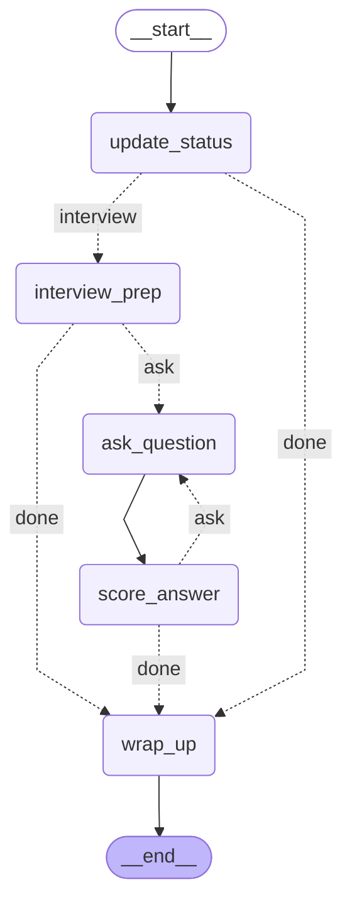
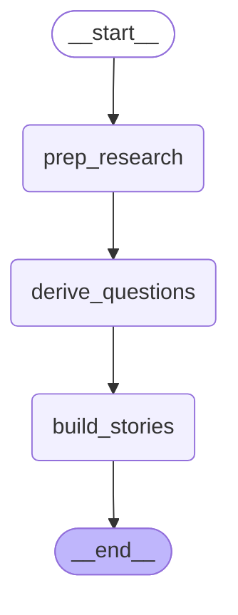

# graphs/tracker/

## Purpose
The second graph: track applications after CareerGraph marked them "ready", with validated
status transitions, and turn an "interview" status into interview prep plus a mock interview.

## How it works
<!-- graph:tracker:start -->

<!-- graph:tracker:end -->

`interview_prep` subgraph:

<!-- graph:interview_prep:start -->

<!-- graph:interview_prep:end -->

- `update_status` validates the transition (`domain/status.py`: saved, ready, applied,
  screening, interview, offer, rejected, withdrawn) and records an event.
- The router `on_status` sends "interview" to `interview_prep`; everything else ends.
- `interview_prep` runs the subgraph: `prep_research` **reuses the `research_company`
  subgraph** from `job_search`, `derive_questions` builds likely questions from the stored
  `JobAnalysis` (must-have skills, seniority, behavioral, company), `build_stories` writes STAR
  stories that cite your evidence ids (stories citing unknown ids are dropped).
- `ask_question` calls `interrupt()` once per turn; `score_answer` scores your answer against a
  rubric (structure, relevance, specificity, conciseness, 1-5 each); the loop continues up to
  `MOCK_INTERVIEW_TURNS` or until you answer `/stop`; `wrap_up` reports averages and your
  weakest dimension.

## Key files
`graph.py`, `state.py`, `subgraph.py`, `nodes/` (one file per node),
`../../documents/interview.py` (question derivation).

## LangGraph concepts used and why
A second, independent `StateGraph` sharing the same checkpointer and Store; a router on a state
value; **subgraph reuse across graphs**; an interrupt **per loop iteration** (each answer is a
`Command(resume=answer)`), all at the top level.

## Configuration
`MOCK_INTERVIEW_TURNS`, `ENABLE_COMPANY_RESEARCH` (prep research), `CHEAP_MODEL`.

## How to run and test
```bash
careergraph tracker set <job_id> applied
careergraph tracker set <job_id> interview        # prints the first question
careergraph interview answer <thread> "my answer" # repeat; "/stop" to finish
```
Or use the Tracker page. Tests: `uv run pytest tests/test_tracker.py`.

## Design decisions and trade-offs
Questions are derived deterministically (cheap, explainable); only stories and scoring use the
cheap model. In demo mode scoring is a heuristic (STAR cue words, overlap with the question,
numbers, length): a plumbing check, not a judgement of your answer.

## Extending and gotchas
Interview prep needs a stored analysis of the posting and a cached profile (both exist for
applications created by `job_search`).
