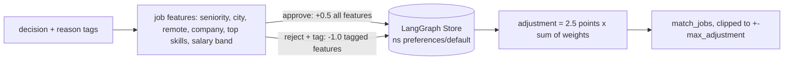

# memory/

## Purpose
Long-term preference memory: learn from your shortlist decisions so the next run ranks jobs
the way you would.

## How it works

Reason tags map to features: `too_junior`/`too_senior` -> seniority, `wrong_location` -> city
and remote type, `not_my_domain` -> top must-have skills, `company` -> company, `salary` ->
salary band. `other`, untagged rejections and deferrals teach nothing. Notes are stored but
never interpreted.

## Key files
`preferences.py`: `job_features`, `learn`, `load`, `adjustment`.

## LangGraph concepts used and why
**Store** (`BaseStore`): cross-thread, durable key-value memory, available to nodes as
`runtime.store`. Checkpoints hold one thread's state; the Store holds what should survive
across threads. Verified: `langgraph.store.sqlite.SqliteStore` (langgraph-checkpoint-sqlite
3.1.3) persists across processes, so no custom table was needed (ADR 0003). Postgres uses
`PostgresStore`.

## Configuration
`criteria.yaml` `preference.enabled`, `preference.max_adjustment`.

## How to test
`uv run pytest tests/test_matching.py -k learning tests/test_service.py`.

## Design decisions and trade-offs
Tags instead of free text: deterministic, explainable, no LLM cost, no prompt-injection
surface. The trade-off is coarser learning. Weights are additive and unbounded in the Store
but clipped when applied.

## Extending and gotchas
To reset learning delete the Store namespace (e.g. remove `data/langgraph-<mode>.db` in demo).
Evals export your decisions with `careergraph eval export-labels`.
