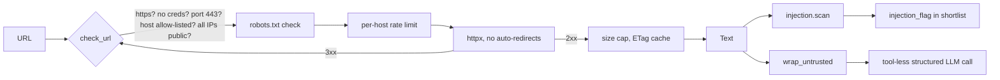

# security/

## Purpose
Treat everything from the internet (postings, company pages, READMEs) as untrusted: scan it
for prompt injection, delimit it in prompts, and fetch it only through an SSRF-safe client.

## How it works

## Key files
| File | What |
|---|---|
| `fetcher.py` | `SafeFetcher`: allowlist, private/loopback/link-local/CGNAT/multicast blocking (IPv4, IPv6, IPv4-mapped), IP literals rejected, manual redirects with re-validation (max 5), byte and time caps, robots.txt (RFC 9309 semantics), per-host interval, honest User-Agent, ETag/Last-Modified disk cache |
| `injection.py` | weighted regex heuristics (ignore-instructions, disregard-rules, reveal-prompt, chat markup, notes to AI, score manipulation, role prefixes, mode switches, zero-width chars); flagged at score >= 1.0 |
| `wrapping.py` | `wrap_untrusted()` delimiter + `UNTRUSTED_NOTICE`; strips zero-width/bidi characters and delimiter look-alikes |

## LangGraph concepts used and why
Security shapes the graph: nodes that read untrusted text (`extract_jobs`, the research
brief) have **no tools** and return **structured output only**. The only tool-using loop
(`research_company`) can fetch only allow-listed domains, is step- and token-capped, and its
output is a cited brief a human sees before anything is used.

## Configuration
`HTTP_TIMEOUT_SECONDS`, `HTTP_MAX_BYTES`, `HTTP_MIN_INTERVAL_SECONDS`, `HTTP_CONTACT`; company
domains from `search.yaml` `companies` and RSS hosts are added to the allowlist at runtime.
Default allowlist: Greenhouse, Lever (+EU), Ashby, GitHub API, Tavily, Brave.

## How to test
`uv run pytest tests/test_fetcher.py tests/test_sources.py -k "injection or fetch"`.

## Design decisions and trade-offs
- Allowlist over denylist: a personal tool talks to a handful of hosts.
- Robots unreachable (5xx/network) means "disallow", per RFC 9309; 4xx means "allow".
- Hidden HTML (`display:none`, comments) is kept in extracted text on purpose so the scanner
  sees it.
- Heuristics give false negatives and positives; the flag informs, it does not block.

## Extending and gotchas
- **DNS rebinding**: the address is validated before httpx resolves again. An attacker who
  controls an allow-listed domain could race the check. Accepted risk for a personal tool;
  pinning the connection to the validated IP is the fix if the allowlist grows.
- Adding a source host? Add it to `DEFAULT_ALLOWED` or derive it from config like RSS hosts.
