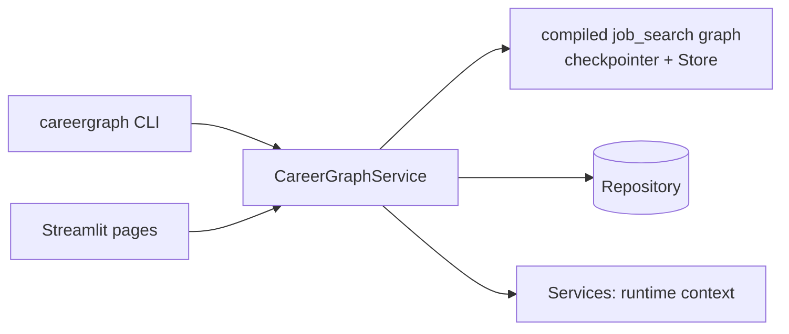

# service/

## Purpose
The single in-process API used by both the CLI and the Streamlit UI. No HTTP server.

## How it works

| Method | What |
|---|---|
| `start_run(on_event)` | new thread, runs until the first pause; streams node updates |
| `list_pending()` | threads waiting for shortlist/review, or resumable after budget halt/crash |
| `get_shortlist(thread)` / `approve_shortlist(thread, decisions)` | first pause |
| `get_review(thread)` / `review_documents(thread, actions)` | second pause |
| `resume(thread, value=None)` | generic `Command(resume=...)`, or continue after a halt |
| `history(thread)` / `fork(thread, checkpoint, updates)` | time travel |
| `run_profile()` / `run_jobs()` | partial graphs for `make profile` / `make jobs` |
| `change_status(job, status)` / `answer_mock(thread, answer)` | tracker graph: validated transitions, interview prep, mock-interview pauses |
| tracker + insights | `list_applications`, `set_status`, `skills_trend`, `usage_by_run`, `render` |

Outcomes are plain dataclasses (`RunOutcome`: `waiting_shortlist`, `waiting_review`,
`completed`, `halted_budget`, `failed`).

## Key files
`api.py` (the service), `wiring.py` (builds `Services`: the only place demo and live differ).

## LangGraph concepts used and why
- **Runtime context** (`context_schema=Services`, `graph.stream(..., context=services)`):
  dependencies reach nodes without being checkpointed.
- **Durable threads**: `thread_id` per run; `get_state().interrupts` tells what a thread waits
  for; `Command(resume=...)` continues it, even from another process hours later.
- **Streaming** with `stream_mode="updates"` drives CLI progress lines and `st.status` in the UI.

## Configuration
Everything in `.env` and `config/`; nothing specific here.

## How to test
`uv run pytest tests/test_service.py tests/test_demo_smoke.py`.

## Design decisions and trade-offs
See ADR 0002: a personal tool does not need an API server and an SPA; one Python process
keeps deployment and auth trivial. To add an API later, wrap these methods in FastAPI
routes one-to-one; the graph and persistence do not change.

## Extending and gotchas
- Resume values are validated here (unknown job ids are rejected) before touching the graph.
- `list_pending` trusts the checkpointer over the `runs` table.
