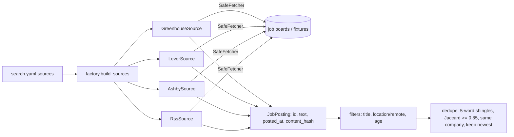

# sources/

## Purpose
Adapters that turn external data into domain objects: job boards (Greenhouse, Lever, Ashby,
RSS), GitHub, the user's documents, and web search for company research. Plus the demo
fixture transport that serves `data/demo/` for the same URLs.

## How it works

| Source | Endpoint (verified against official docs 2026-11-22) | Notes |
|---|---|---|
| Greenhouse | `GET boards-api.greenhouse.io/v1/boards/{token}/jobs?content=true` | `content` is entity-escaped HTML; id `gh-{token}-{id}` |
| Lever | `GET api.lever.co/v0/postings/{site}?mode=json` (EU: `api.eu.lever.co`) | top-level array; `createdAt` (ms) undocumented but present, parsed tolerantly; id `lv-{site}-{uuid[:8]}` |
| Ashby | `GET api.ashbyhq.com/posting-api/job-board/{name}?includeCompensation=true` | per-job `compensation` (docs show it top-level); unlisted jobs skipped; id `ab-{name}-{uuid[:8]}` |
| RSS/Atom | any https feed URL | bytes fetched by SafeFetcher, parsed by feedparser; id `rss-{host}-{sha1(guid)[:8]}` |
| GitHub | `/users/{u}/repos`, `/repos/{o}/{r}/languages`, `/repos/{o}/{r}/readme` (raw) | forks/archived skipped; `X-GitHub-Api-Version: 2022-11-28`; optional token |
| Search | Tavily `POST /search` (Bearer), Brave `GET /res/v1/web/search` (`X-Subscription-Token`), `site` (no key) | see `websearch.py` docstring for free-tier notes (check current pricing) |

## Why not LinkedIn or Indeed?
Neither offers a public job-search API for individuals, and their terms of service prohibit
scraping. CareerGraph only uses documented public endpoints (ATS job boards most companies
expose for their own careers pages) and RSS feeds, identifies itself honestly and respects
robots.txt.

## Key files
`jobs/{greenhouse,lever,ashby,rss}.py` (parse functions are pure and unit-tested on fixtures),
`jobs/factory.py`, `jobs/filters.py`, `jobs/ids.py`, `github.py`, `documents.py` (pypdf, LaTeX
stripping, pinned evidence), `html.py`, `websearch.py`, `fixtures.py`.

## LangGraph concepts used and why
Adapters are plain Python called from nodes through the runtime context (`Services`), so the
graph never knows whether it is talking to the internet or fixtures.

## Configuration
`search.yaml` (sources, titles, locations, max_age_days, companies), `profile.yaml`
(documents, github), `GITHUB_TOKEN`, `SEARCH_PROVIDER`, `TAVILY_API_KEY`, `BRAVE_API_KEY`.

## How to run and test
`uv run pytest tests/test_sources.py tests/test_profile.py tests/test_jobs_nodes.py`.
Fixture payloads are regenerated by `data/demo/build_fixtures.py`.

## Design decisions and trade-offs
- Failure-tolerant per source: one broken board is logged in the run funnel, not fatal.
- Content hash over (title, location, text) decides re-analysis; unchanged postings cost nothing.
- Near-duplicate detection is per company only, to avoid merging similar roles elsewhere.

## Extending and gotchas
- New ATS: add `parse_x()` + `XSource`, an id scheme in `ids.py`, a branch in `factory.py`,
  its host in the fetcher allowlist, and a route in `fixtures.py` with a fixture file.
- Board slugs are never guessed: the live `search.yaml` ships with placeholders.
- Scanned PDFs have no text layer (no OCR).
