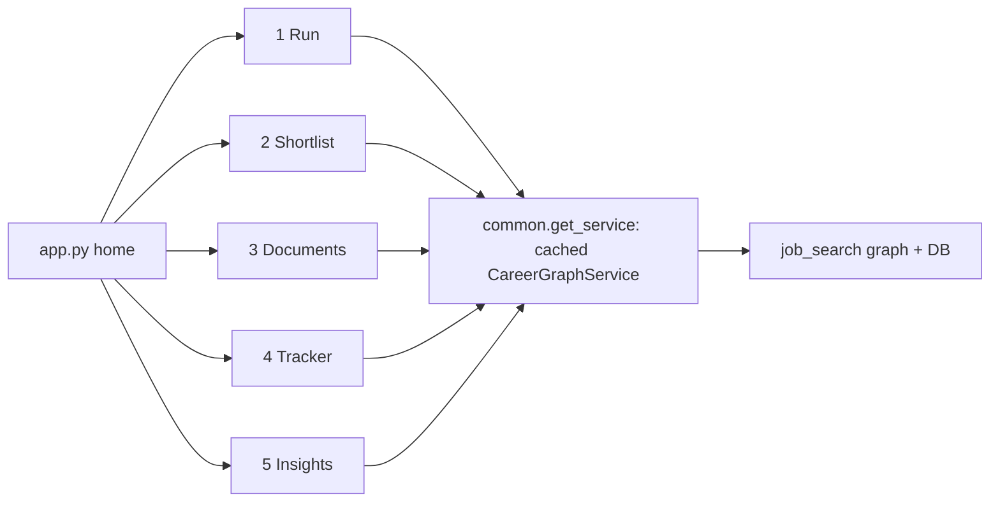

# ui/

## Purpose
A small Streamlit multipage app on top of the service layer: start runs, make the two human
decisions, download documents, track applications, see insights. No custom JavaScript, no
frontend build, no CSS beyond Streamlit defaults.

## How it works

| Page | What you do |
|---|---|
| Run | start a run (`st.status` shows each node as it finishes, via `stream_mode="updates"`), see pending threads, resume halted ones, browse checkpoint history and fork (time travel) |
| Shortlist | per job: score breakdown, matched / partial (via related skill) / missing skills with evidence ids, rationale, injection and red-flag warnings; approve / reject / defer, reason tags, note |
| Documents | per draft: verification label per claim with evidence quote, the verifier's catch log, editable claims, approve / edit / regenerate / reject, override for flagged drafts; download .tex, .pdf, report.md |
| Tracker | applications and validated status transitions with history |
| Insights | skills demand per week; tokens (and USD when priced) per run, with fake-mode rows labelled |

## Key files
`app.py`, `common.py` (service cache, password gate, outcome rendering), `pages/*.py`.

## LangGraph concepts used and why
The UI never touches the graph directly. It shows interrupt payloads (`get_shortlist`,
`get_review`) and sends resume values (`approve_shortlist`, `review_documents`); progress
comes from streamed node updates. Because state is checkpointed, you can close the browser
and continue later, or continue in the CLI.

## Configuration
`UI_HOST` (default 127.0.0.1), `UI_PORT`, `UI_PASSWORD` (required when
`APP_ENV=production`; compared in constant time).

## How to run and test
`make ui` (or `make demo` first for data). Tests: `uv run pytest tests/test_ui.py` uses
Streamlit's headless `AppTest` to render every page and to drive run -> shortlist -> review
-> tracker through the forms.

## Design decisions and trade-offs
Streamlit keeps the UI in Python and in-process (ADR 0002). Trade-offs: whole-page reruns and
a single-user mindset, both fine for a personal tool.

## Extending and gotchas
- Pages add `ui/` to `sys.path` so `common` is importable both under `streamlit run` and
  `AppTest.from_file`.
- `st.page_link` resolves paths relative to the entrypoint, so it is only used on the home page.
- Binding to 0.0.0.0 (Docker) without `UI_PASSWORD` is reported by `make doctor`.
